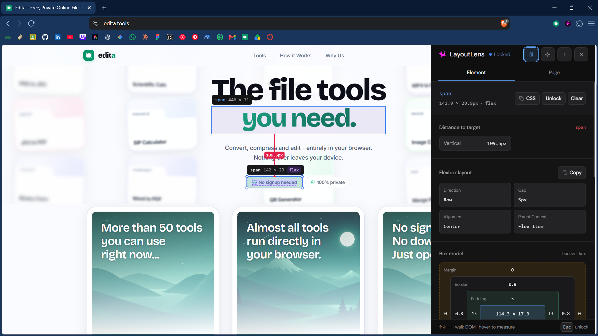
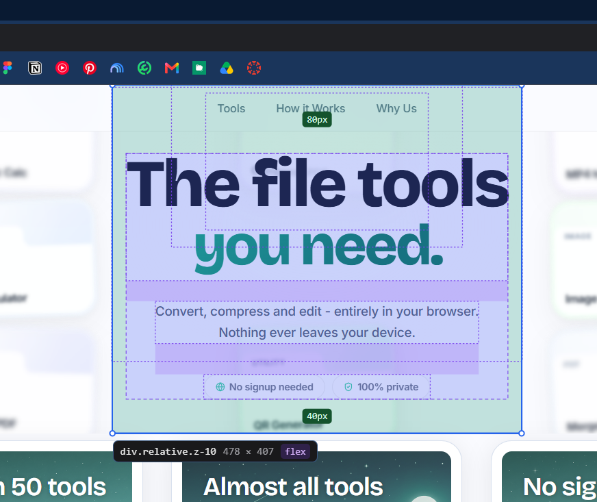

<div align="center">
  
  <h1>LayoutLens</h1>
  <p><strong>Inspect, but better.</strong></p>
  <p>
    An open-source Chromium extension for developers and designers to inspect rendered layouts,
    measure pixel distances, analyze page design systems, and copy code in CSS, Tailwind, SwiftUI, and Jetpack Compose — completely locally in your browser.
  </p>

  <p>
    <a href="#installation">Install</a> ·
    <a href="#features">Features</a> ·
    <a href="#keyboard-shortcuts">Shortcuts</a> ·
    <a href="#architecture">Architecture</a> ·
    <a href="#development">Development</a>
  </p>
</div>

---



## Why LayoutLens?

Chrome DevTools is built for deep debugging, not fast visual reading. LayoutLens slides cleanly over the right edge of any webpage **without squishing the viewport**, letting you understand how a site is constructed in seconds:

- **What am I looking at?** Instant bounding boxes, selector + pixel badges, DOM hierarchy, and Shadow DOM support.
- **How is it positioned?** Plain-English Flexbox & CSS Grid breakdowns, visual track/gap overlays, and Figma-style element-to-element distance rulers.
- **How is it styled?** Click-to-copy Box Model schematic, resolved typography, color swatches, and live WCAG contrast ratios.
- **How do I reuse it?** Copy any element or the entire page's design system as **CSS**, **Tailwind v4**, **SwiftUI (iOS)**, **Jetpack Compose (Android)**, **W3C Design Tokens JSON**, or a **Markdown report**.

Everything runs **100% locally** using native browser APIs (`getComputedStyle`, `getBoundingClientRect`, `elementsFromPoint`, `ResizeObserver`, `MutationObserver`) — no accounts, no cloud sync, no external API calls.

---

## Features

### 1. Slide-In Drawer & Collapsible Peek Mode
- Opens flush along the right edge (`420px` wide) over the page so responsive layouts never reflow.
- Starts **Idle** so you can browse normally; click the crosshair button whenever you want to inspect.
- Click the **`>` collapse button** to slide the panel into a slim `<` pull-tab on the right edge so you can inspect elements positioned behind the panel.
- Built-in **Dark / Light** theme toggle and a floating bottom-left bar (`Box`, `Guides`, `Measure`, `Unlock`, `×`) while inspecting.

### 2. Visual Layout Overlays & Distance Ruler
- **Box Model Overlay**: Color-coded margin, border, and padding bands with numeric pixel pills.
- **Smart Flex & Grid Guides**: Highlights Flex gap strips, item bounds, and CSS Grid column/row tracks — and subtly reveals parent Flex/Grid tracks even when hovering child items.
- **Element-to-Element Measurement**: Click any element to lock it, then hover any other element to measure horizontal/vertical gaps or parent-child inner offsets with dashed alignment guides.



### 3. Two-Mode Inspector (`Element` | `Page`)
- **`Element` mode**: One unified, scannable spec sheet per element — selector & dimensions, live distance readout, plain-English Flexbox/Grid insights, click-to-copy Box Model schematic, Typography + Color swatches with WCAG contrast (`AAA` / `AA` / `AA Large` / `Fail`), multi-language code block, and collapsible DOM path & computed styles.
- **`Page` mode**: Auto-scans rendered elements on the page to extract the viewport & breakpoint, color palette, typography scale, spacing scale, border radii, centered/max-width containers, nested Flex/Grid hierarchy, and consistency notes (near-duplicate colors, off-grid spacing).

### 4. Multi-Language Code & Design System Export

| Target | Single Element (`Element` mode) | Full Page Design System (`Page` mode) |
| --- | --- | --- |
| **CSS** | Clean rendered CSS rule | `:root` CSS custom properties (`.css`) |
| **Tailwind** | Utility class markup (`flex`, `gap-*`, `p-*`, `rounded-*`, hex) | Tailwind v4 `@theme` stylesheet (`.css`) |
| **SwiftUI (iOS)** | `HStack` / `VStack` / `LazyVGrid` / `Text` modifier chain | `enum DesignTokens` + `Color(hex:)` extension (`.swift`) |
| **Jetpack Compose (Android)** | `Row` / `Column` / `LazyVerticalGrid` / `Text` + `Modifier` | `object DesignTokens` Kotlin file (`.kt`) |
| **W3C JSON & Report** | — | W3C Design Tokens (`.json`) & Markdown audit report (`.md`) |

---

## Keyboard Shortcuts

All shortcuts work whether keyboard focus is on the webpage or inside the LayoutLens drawer:

| Shortcut | Action |
| --- | --- |
| `Alt + Shift + L` | Open or close the LayoutLens drawer |
| `Click` *(while Live)* | Lock selection on the hovered element (intercepts page clicks safely) |
| `Esc` | Step 1: Unlock locked element → Step 2: Pause inspection → Step 3: Close drawer |
| `↑` `↓` `←` `→` *(while Locked)* | Walk DOM: parent (`↑`), first child (`↓`), previous sibling (`←`), next sibling (`→`) |
| `←` `→` *(on tab bar)* | Switch between `Element` and `Page` modes |

---

## Installation

### Prerequisites
- [Bun](https://bun.sh/) `>= 1.1` (or Node.js `>= 20`)
- Any Chromium browser (Chrome, Brave, Arc, Edge, Vivaldi)

### Build from Source

```bash
git clone https://github.com/<your-username>/layoutlens.git
cd layoutlens
bun install
bun run build
```

### Load Unpacked in Chrome / Brave / Edge
1. Open `chrome://extensions` (or `brave://extensions` / `edge://extensions`).
2. Enable **Developer mode** in the top-right corner.
3. Click **Load unpacked** and select the generated `dist/` folder.
4. Visit any `http://` or `https://` website and click the **LayoutLens** toolbar icon (or press `Alt+Shift+L`).

---

## Architecture

LayoutLens keeps the inspection, analysis, and export engines **completely framework-independent** (no React or `chrome.*` imports in `src/core/` or `src/exporters/`):

```text
layoutlens/
├── public/icons/             # Extension PNG icons (16, 48, 128) & vector SVG mark
├── docs/screenshots/         # README screenshots
├── manifest.config.ts        # Chrome Manifest V3 configuration (CRXJS)
├── src/
│   ├── background/
│   │   └── service-worker.ts # Ephemeral MV3 worker (toolbar toggle, badge, fallback injection)
│   ├── content/
│   │   ├── index.ts          # Content script entrypoint & global shortcut fallback
│   │   ├── controller.ts     # Pointer/click capture, ResizeObserver, MutationObserver, rAF loop
│   │   └── overlay/
│   │       ├── drawer-host.ts   # Shadow DOM flush slide-in drawer + collapsible right-edge tab
│   │       ├── overlay-host.ts  # Shadow DOM SVG canvas + bottom-left floating HUD
│   │       ├── box-model.ts     # Margin/border/padding/content bands & edge pills
│   │       ├── highlight.ts     # Bounding outlines, badges, Flex/Grid track guides
│   │       └── measurements.ts  # Element-to-element pixel rulers & dashed alignment guides
│   ├── core/                 # Framework-independent inspection & analysis modules
│   │   ├── scanner/          # TreeWalker & open Shadow DOM piercing
│   │   ├── geometry/         # Bounding rects, box model, sibling & nested distances
│   │   ├── styles/           # Categorized computed CSS & rule formatting
│   │   ├── typography/       # Font stacks, line-height ratios, page typography scale
│   │   ├── colors/           # Hex/RGBA normalization, WCAG contrast, page palette
│   │   ├── layout/           # Flex/Grid detection, grid tracks, containers, breakpoints
│   │   ├── hierarchy/        # Ancestor chains & direct children
│   │   └── analysis/         # Element inspector & bounded page design-system scanner
│   ├── exporters/            # Pure code & token generators (CSS, Tailwind, SwiftUI, Compose, JSON, MD)
│   ├── messaging/            # Direct token-authenticated iframe↔content bridge + Zod schemas
│   ├── shared/               # Shared types, constants, and CSS/color utilities
│   └── sidepanel/            # React 19 + Tailwind CSS v4 drawer UI (Element & Page views)
└── tests/                    # Vitest unit tests (geometry, inspection, exporters, shortcuts)
```

### Tech Stack
- **Language**: TypeScript (strict mode)
- **UI**: React 19, Tailwind CSS v4, Lucide Icons, bundled DM Sans Variable font
- **Build & MV3**: Vite 6, `@crxjs/vite-plugin`, Bun
- **Validation & Testing**: Zod, Vitest, jsdom

---

## Development

```bash
bun run dev        # Start Vite + CRXJS dev server
bun run typecheck  # Run strict TypeScript check (tsc --noEmit)
bun run test       # Run Vitest unit tests (19 tests across 4 suites)
bun run build      # Typecheck and build production bundle into dist/
```

---

## Contributing

Contributions, bug reports, and feature ideas are welcome!

1. Fork the repository and create a feature branch (`git checkout -b feat/my-improvement`).
2. Keep `src/core/` and `src/exporters/` free of React and `chrome.*` dependencies so they remain reusable and easy to unit test.
3. Run `bun run typecheck && bun run test && bun run build` before opening a pull request.

---

## License

MIT — see [LICENSE](./LICENSE).
